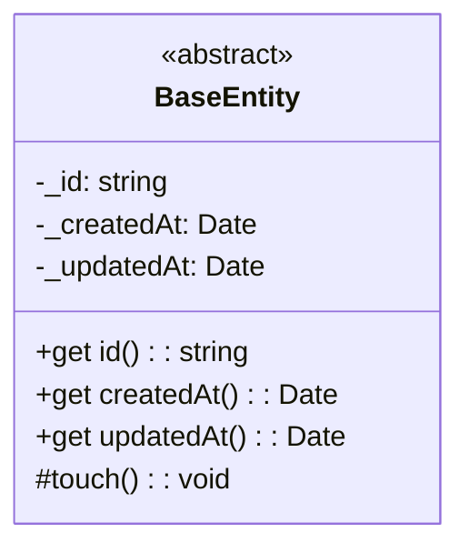
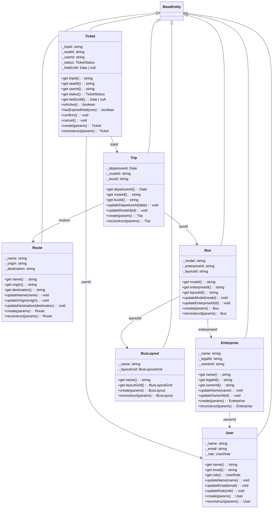

# Domain Entities

## BaseEntity

Abstract base class shared by every domain entity. Holds identity and
timestamp fields; subclasses own their own state and call `touch()` on
mutation.



| Property | Type | Description |
|----------|------|-------------|
| `id` | `string` | UUIDv7, generated in `generateBaseEntityProps()` |
| `createdAt` | `Date` | Creation timestamp (immutable) |
| `updatedAt` | `Date` | Last modification timestamp (advanced by `touch()`) |

`touch()` is `protected` — subclasses call it from their `updateX` methods to
bump `updatedAt`. The domain `BaseEntity` is mirrored by the infra
`BaseEntitySchema` (`defineEntity({ abstract: true })`), which maps the same
fields to columns.

> **Note**: There is no `deletedAt` field. Soft delete is a per-aggregate
> decision, not a cross-cutting concern — adding it to `BaseEntity` would force
> every entity into the same deletion model.

---

## Relationships



Foreign keys are plain `string` IDs in the domain (no typed references).
Infrastructure entities declare ORM relations in one of two forms. A relation
that only carries the foreign key uses `mapToPk`: `p.oneToOne(X).mapToPk()`
(Enterprise→User) and `p.manyToOne(X).mapToPk()` (Bus→Enterprise, Trip→Route).
A relation that a use case reads as a loaded object uses a full
`p.manyToOne(X)` (Bus→BusLayout, Trip→Bus, Ticket→Trip, Ticket→User).

In both forms the relation is the foreign key column, so the column names stay
the same (`layout_id`, `bus_id`, `trip_id`, `user_id`). Read the key through the
relation (`bus.layout`). Write it with `em.getReference(...)`. See
`docs/rules/relations.md`.

---

## Enterprise

| Property | Type | Description |
|----------|------|-------------|
| `id` | `string` | UUIDv7 (inherited) |
| `name` | `string` | Enterprise name |
| `legalId` | `string` | Legal ID (unique, immutable) |
| `ownerId` | `string` | FK → User (unique, one-to-one) |
| `createdAt` | `Date` | Creation timestamp (inherited) |
| `updatedAt` | `Date` | Last modification (inherited) |

**Immutable**: `legalId` — set on creation, no update method.

Each enterprise has exactly one owner (User). The `ownerId` FK is unique on
the `enterprises` table, enforcing the one-to-one constraint at the DB level.

```typescript
const enterprise = Enterprise.create({ name: 'Acme Bus Co.', legalId: 'US-12-3456789', ownerId });
enterprise.updateName('Acme Bus Co. Intl.');
enterprise.updateOwnerId(newOwnerId);
```

---

## Route

| Property | Type | Description |
|----------|------|-------------|
| `id` | `string` | UUIDv7 (inherited) |
| `name` | `string` | Route name |
| `origin` | `string` | Origin terminal |
| `destination` | `string` | Destination terminal |
| `createdAt` | `Date` | Creation timestamp (inherited) |
| `updatedAt` | `Date` | Last modification (inherited) |

No FKs — standalone entity.

```typescript
const route = Route.create({ name: 'Central - North', origin: 'Terminal Central', destination: 'Terminal Norte' });
```

---

## User

| Property | Type | Description |
|----------|------|-------------|
| `id` | `string` | UUIDv7 (inherited) |
| `name` | `string` | User name |
| `email` | `string` | Email (unique) |
| `role` | `UserRole` | `'admin' \| 'driver' \| 'user'` |
| `createdAt` | `Date` | Creation timestamp (inherited) |
| `updatedAt` | `Date` | Last modification (inherited) |

`UserRole` is a union type exported from the domain entity. DTOs validate
with `@IsIn(USER_ROLES)`. The MikroORM `UserEntity.role` is typed as
`UserRole` directly — no `as` casts in repositories.

A user may own an enterprise (the ownership is modeled from the Enterprise
side via `ownerId`). A user with no enterprise is valid.

```typescript
const user = User.create({ name: 'Jane Driver', email: 'jane@acme.com', role: 'driver' });
user.updateRole('admin');
```

---

## Bus

| Property | Type | Description |
|----------|------|-------------|
| `id` | `string` | UUIDv7 (inherited) |
| `model` | `string` | Bus model |
| `enterpriseId` | `string` | FK → Enterprise |
| `layoutId` | `string` | FK → BusLayout, not null |
| `createdAt` | `Date` | Creation timestamp (inherited) |
| `updatedAt` | `Date` | Last modification (inherited) |

Identified by UUID only — no plate field.

**Immutable**: `layoutId` — set on creation, no update method. Every bus has
exactly one layout, the blueprint of its seats. A layout row is a template:
two buses can reference the same one.

```typescript
const bus = Bus.create({ model: 'Mercedes-Benz O500', enterpriseId, layoutId });
```

---

## Trip

| Property | Type | Description |
|----------|------|-------------|
| `id` | `string` | UUIDv7 (inherited) |
| `departureAt` | `Date` | Departure timestamp |
| `routeId` | `string` | FK → Route |
| `busId` | `string` | FK → Bus, not null |
| `createdAt` | `Date` | Creation timestamp (inherited) |
| `updatedAt` | `Date` | Last modification (inherited) |

`departureAt` is `Date` in the domain, `timestamptz` in infra, ISO string in
DTOs (`@IsDateString()`). Use cases convert with `new Date(dto.departureAt)`.

**Immutable**: `busId` — assigned when the trip is created. `PUT /trips/:id`
answers 400 if the request contains it.

```typescript
const trip = Trip.create({ departureAt: new Date('2026-08-10T08:00:00Z'), routeId, busId });
```

`GET /trips/:id` returns the trip, its bus, and the bus layout grid. The query
uses one SQL statement with two joins.

---

## BusLayout

| Property | Type | Description |
|----------|------|-------------|
| `id` | `string` | UUIDv7 (inherited) |
| `name` | `string` | Template name |
| `layoutGrid` | `BusLayoutGrid` | jsonb blueprint of the seat map |
| `createdAt` | `Date` | Creation timestamp (inherited) |
| `updatedAt` | `Date` | Last modification (inherited) |

There are no update methods: a layout is a template, created once and read by
every bus that references it. The grid types, the two seeded templates, and the
deck prefixes live in `src/domain/entities/bus-layout-grid.ts`.

```typescript
interface BusLayoutGrid {
  levels: number;    // 1 single deck, 2 double deck
  rows: number;
  columns: number;
  nodes: BusLayoutGridNode[];
}

interface BusLayoutGridNode {
  id: string;        // '1A' single deck, 'L1A' / 'U1A' double deck
  label: string;     // '1A' — repeats per deck
  type: 'seat' | 'aisle' | 'bathroom' | 'stairs';
  level: number;
  row: number;
  column: number;
}
```

Only nodes of type `seat` are bookable. The deck prefixes keep node IDs unique
across levels. As a result, `(trip_id, seat_id)` identifies a seat without
ambiguity.

```typescript
const layout = BusLayout.create({
  name: STANDARD_BUS_LAYOUT_NAME,
  layoutGrid: buildStandardBusLayoutGrid(),
});
```

---

## Ticket

| Property | Type | Description |
|----------|------|-------------|
| `id` | `string` | UUIDv7 (inherited) |
| `tripId` | `string` | FK → Trip |
| `seatId` | `string` | Grid node id of the trip's bus, for example `1A`, `L1A`, `U1A` |
| `userId` | `string` | FK → User, the passenger holding the seat |
| `status` | `TicketStatus` | `'held' \| 'booked' \| 'cancelled'` |
| `heldUntil` | `Date \| null` | Hold expiration, only on `held` |
| `createdAt` | `Date` | Creation timestamp (inherited) |
| `updatedAt` | `Date` | Last modification (inherited) |

Seat states: `held` (temporary checkout lock, must carry `heldUntil`) →
`booked` (confirmed, hold cleared) → `cancelled` (seat released). `create`
accepts `held` or `booked` only. Cancellation goes through `cancel()`.

```typescript
const ticket = Ticket.create({ tripId, seatId: '1A', userId, status: 'held', heldUntil });
ticket.confirm();  // booked, hold cleared
ticket.cancel();   // cancelled, seat freed
```

`isActive()` is true while the status is not `cancelled`. This rule is the exact
predicate of the partial unique index on the `tickets` table:

```sql
create unique index "tickets_trip_id_seat_id_unique"
    on "tickets" ("trip_id", "seat_id") where "status" != 'cancelled';
```

What that means in practice:

- Two active tickets can never share a seat. The database rejects the second
  one, so two concurrent requests cannot both take it.
- An expired hold still blocks its seat, because an index cannot read the
  clock. Release the seat with `cancel()`. `hasExpiredHold(now)` reports when
  the hold is due.
- Cancelled tickets stay in the table as history. They reserve nothing.
- The database does not check `seatId` against the layout. The rule that a seat
  must exist as a `seat` node in `trip → bus → layout.layoutGrid` belongs to
  the booking use case. That use case is the only layer that can read the
  layout of the trip's bus.

`TicketStatus` is a union type, exported from the domain entity. DTOs will
validate it with `@IsIn(TICKET_STATUSES)`.

The `status` column is a checked enum as well. MikroORM renders `p.enum` as
`text` plus a check constraint, and it builds the constraint from
`TICKET_STATUSES`. As a result, Postgres and SQLite reject a value outside the
vocabulary:

```sql
alter table "tickets" add constraint "tickets_status_check"
    check ("status" in ('held', 'booked', 'cancelled'));
```

This constraint is necessary. The partial index above compares against the
exact string `'cancelled'`. A row with a mistyped status (`'HELD'`,
`'Cancelled'`) counts as active and holds its seat forever. No domain
transition can release that seat. MikroORM also rejects an out-of-vocabulary
value before the statement reaches the database.

---

## Factory Methods

Every entity has two factory methods — never use `new` outside the class:

- **`create(props)`** — generates UUIDv7 + timestamps via `generateBaseEntityProps()`
- **`reconstruct(props)`** — restores from persisted data, takes `id`, `createdAt`, `updatedAt` as part of props

Repository interfaces live next to each use case under
`src/application/use-cases/{domain}/{action}-{entity}/` and follow the
one-repository-per-operation pattern documented in `AGENTS.md`.